# MetaHuman for Blender (Unofficial)

**Your MetaHumans, alive in Blender.**

> This is an independent project. It has no affiliation with Epic Games, the maker of Unreal Engine
> and MetaHuman, or with the Blender Foundation, and is not endorsed or sponsored by either.

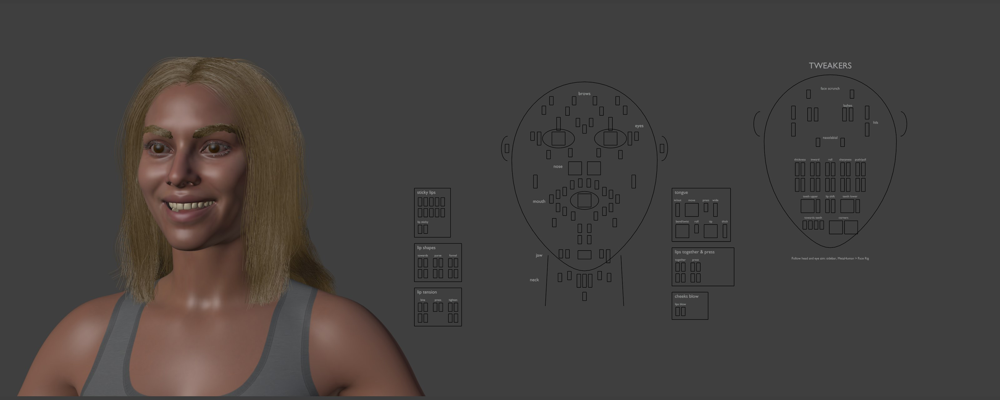

Bring your MetaHumans into Blender and make them your own: animate the face, sculpt new expressions, perfect how the body bends, style hair, then send it all back to
Unreal Engine 5. The face and body rigs run live the whole time, so what you see in Blender is
exactly what you get in Unreal.

**[Download the latest release](https://github.com/kvriel/MetaHumanForBlender/releases)** ·
**[Website](https://kvriel.github.io/MetaHumanForBlender/)** ·
**[How to use it](docs/HOW_TO_USE.md)** · Free and open source

## Why you'll love it

- 🎭 **A living face, right in Blender.** The full MetaHuman face rig runs live as you work. Every
  smile, blink and frown moves the face just as it does in Unreal, wrinkles included.
- 🔁 **A true round trip.** Take a character from Unreal to Blender and back without losing a
  thing. Your edits land in Unreal exactly as you made them.
- 🛠️ **The whole MetaHuman toolset, in one add-on.** Assemble characters, edit expressions, tune
  body poses and export hair, all from one MetaHuman menu.
- 🎨 **Work the Blender way.** Sculpt, paint weights, keyframe and render with the tools you
  already know.
- ⚡ **Install and go.** One installer for Windows or macOS. Nothing else to download, no extra
  plugins, no setup.

| A head built from its DNA | Wrinkles that come alive | A body that bends naturally |
|:---:|:---:|:---:|
| 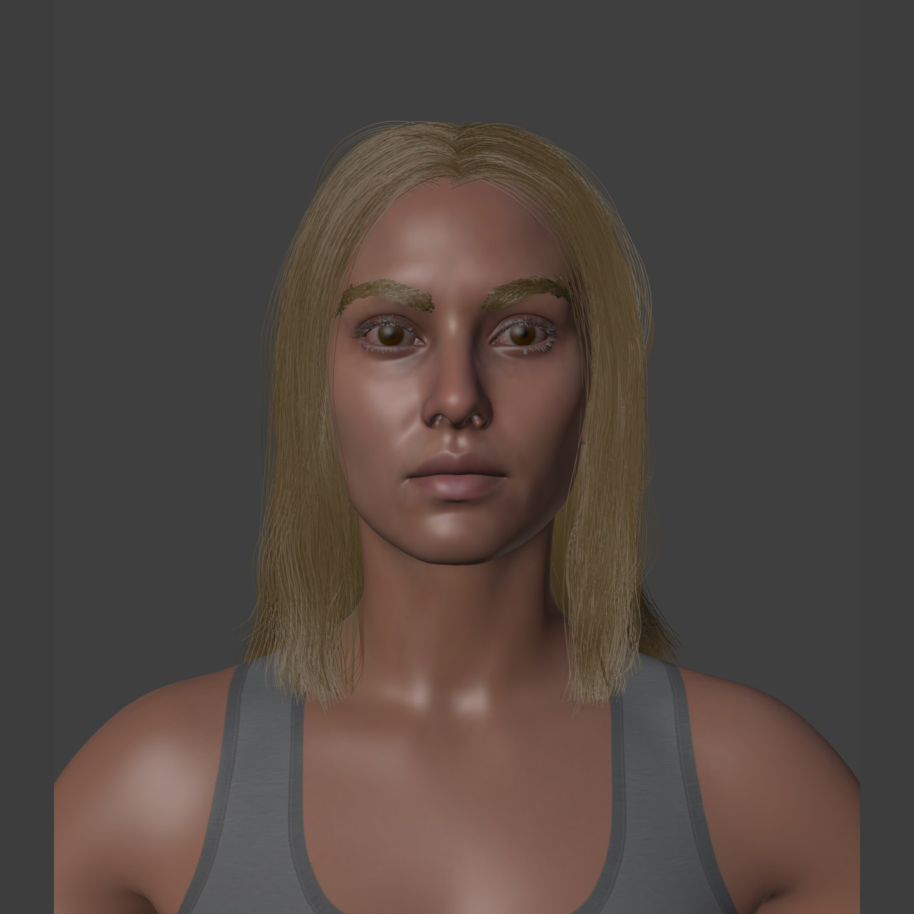 | 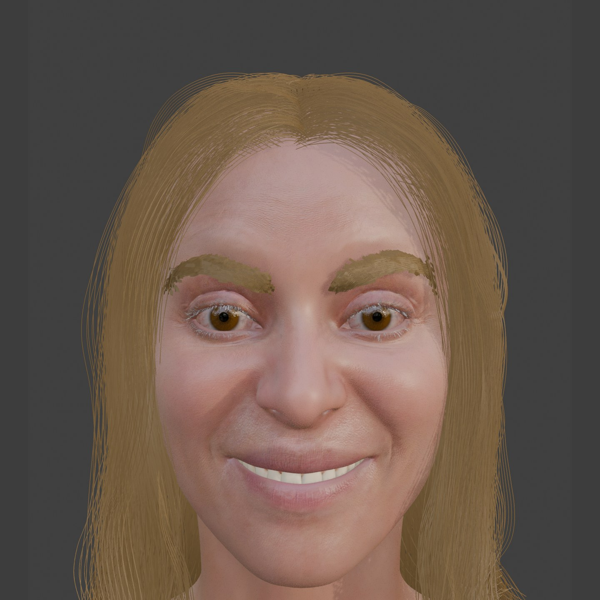 | 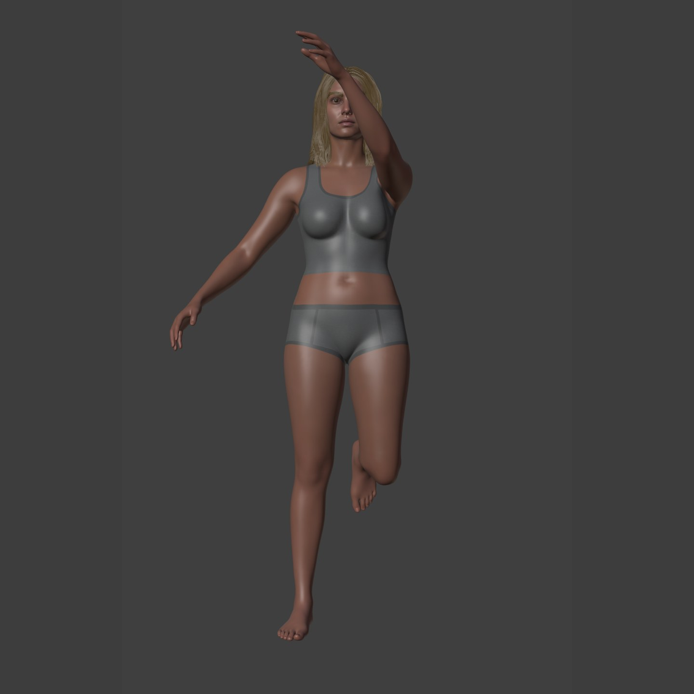 |
| Meshes, skin and eyes, ready in seconds | Forehead lines and crow's feet appear as the face moves | Shoulders, elbows and knees keep their shape in any pose |

## What you can do

### Bring any MetaHuman into Blender

Pick a character from a gallery of your MetaHumans and click **Assemble**. In moments you have the
complete character: head and body, skin and eye textures, every level of detail, and a rig that's
ready to animate.

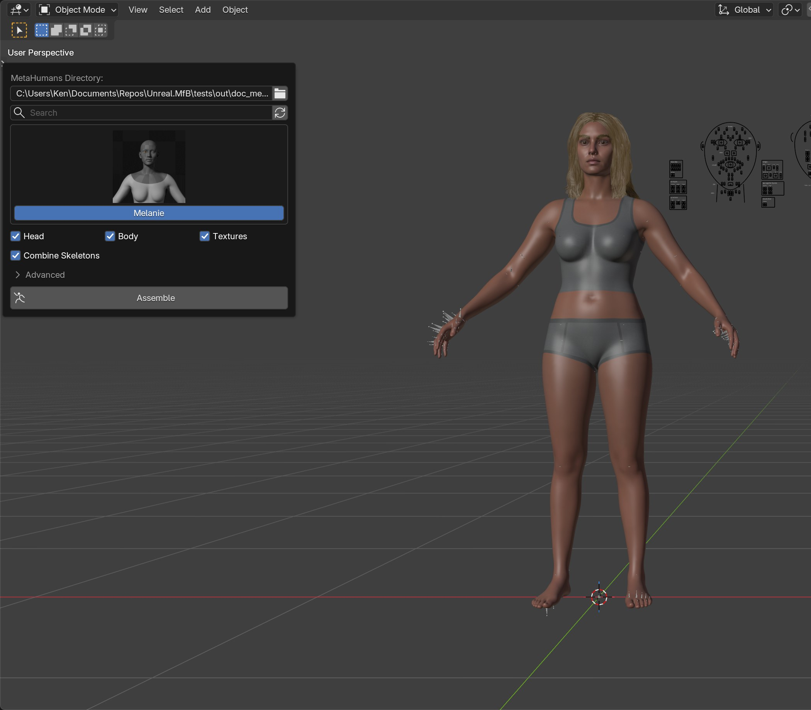

[Character Assembler →](docs/character-assembler.md)

### Animate the face like a pro

Drive the face from the familiar MetaHuman face board, or reach for the individual controls when
you need fine detail. Make the eyes follow a target, key a performance and play it back, with
wrinkles deepening and fading as the face moves.

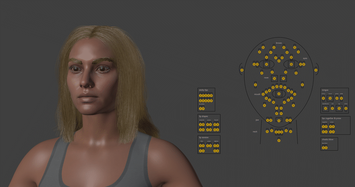

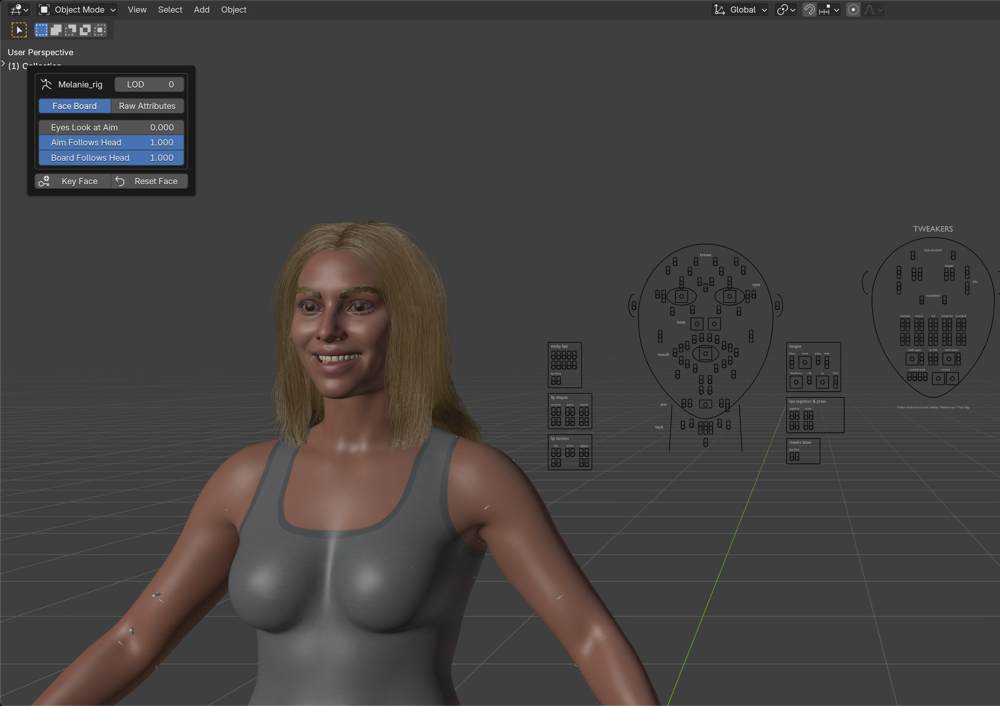

[Face Rig →](docs/face-rig.md)

### Shape faces and sculpt expressions

The Expression Editor gives you full creative control over the face:

- **[Neutral Pose](docs/neutral-pose.md):** reshape the face at rest, and the rig and every level of
  detail follow along.
- **[Expression Poses](docs/expression-poses.md):** sculpt any expression with Blender's brushes.
  Lock the ones you love, and let your changes flow through to the expressions built on them.
- **[Skin Weights](docs/skin-weights.md):** paint exactly how each part of the face moves.
- **[Joints Matching](docs/joints-matching.md):** fit the face joints to a reshaped face in one
  click, and copy joint motion from one expression to another.

Bookmark your favourite poses, play a range-of-motion animation to see every expression in turn,
and save the result as a new DNA file.

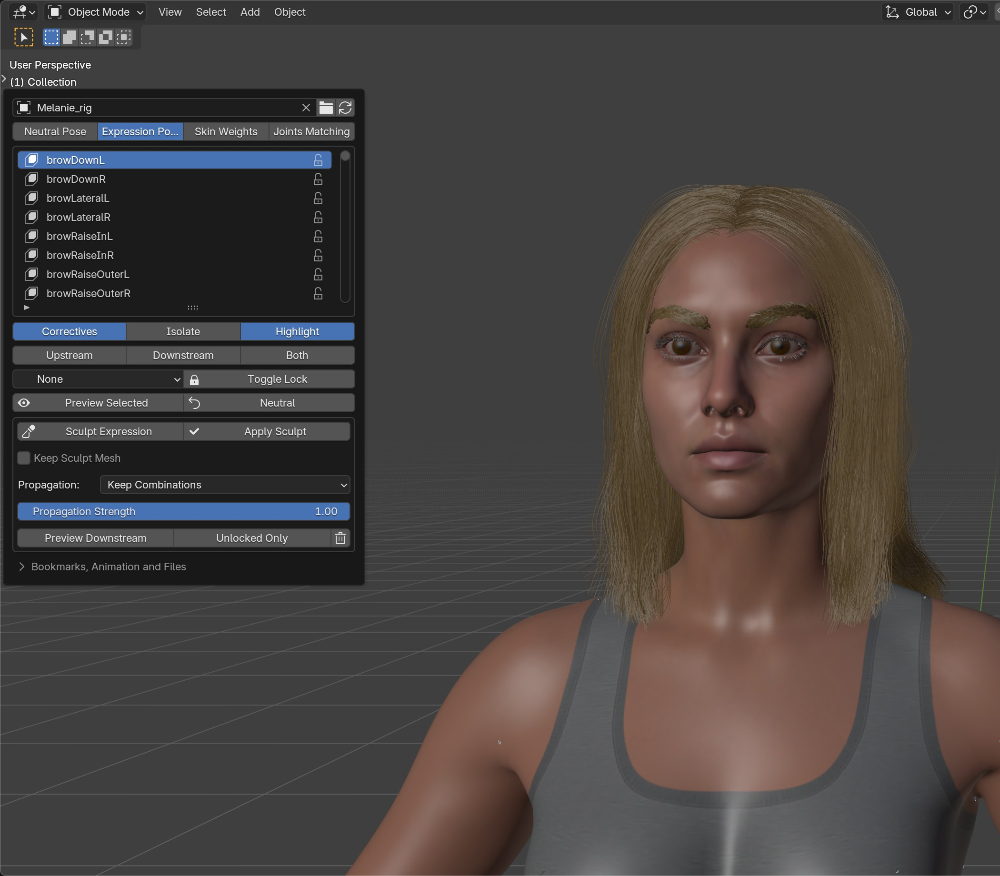

### Perfect how the body bends

No more shoulders that collapse or elbows that pinch. The Pose Editor lets you fix any joint
with corrective poses: pose the helper joints until it looks right, mirror it to the other side, add
in-between steps for smooth motion, and check your work before you export.

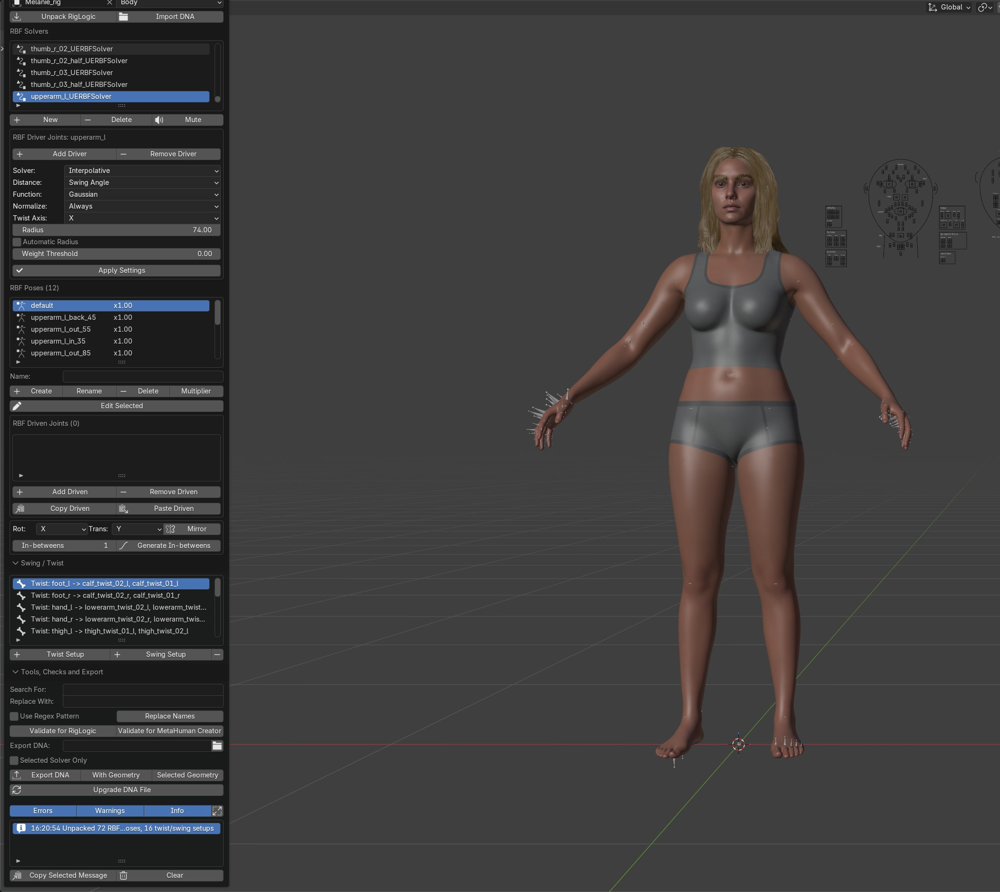

[Pose Editor →](docs/pose-editor.md)

### Style hair for Unreal

Groom hair with Blender's hair tools, then export it as an Unreal-ready groom with one click.
Save your settings as presets to reuse on every character.

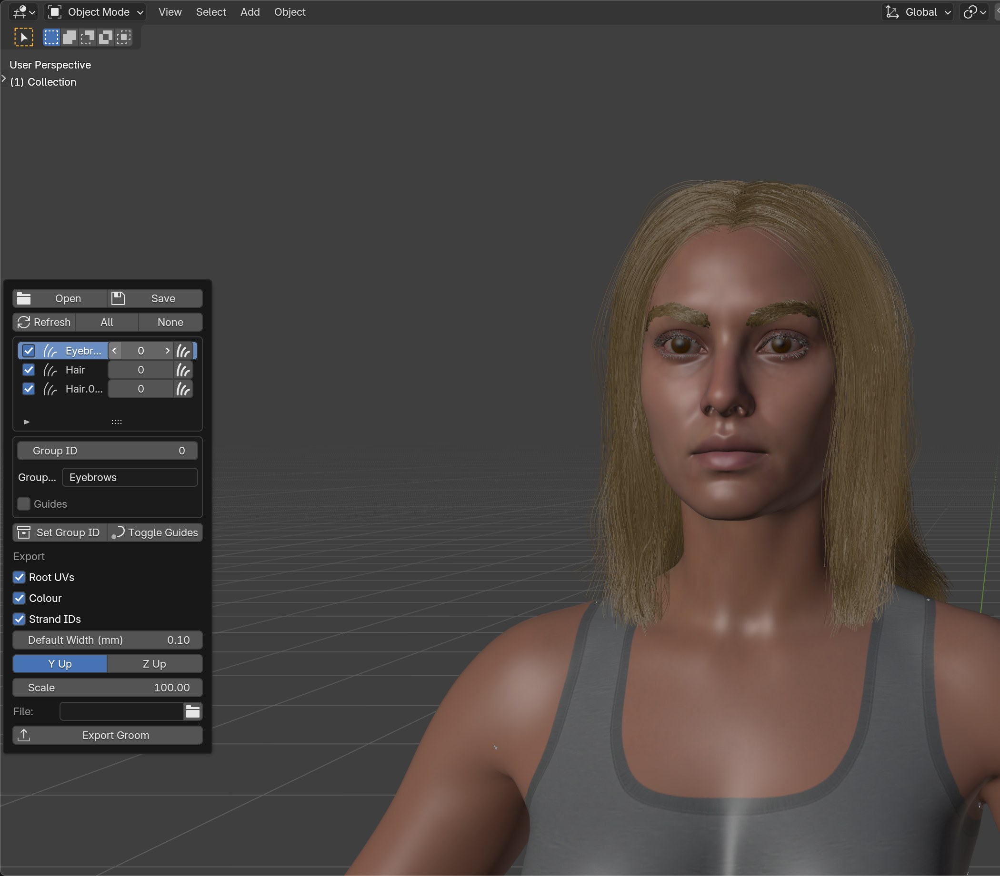

[Groom Exporter →](docs/groom-exporter.md)

### Send it home to Unreal

When you're done, export everything Unreal needs: the character's DNA, a character FBX and your
face animation. A ready-made script loads the animation into Unreal for you, and the face moves
there exactly as it did in Blender.

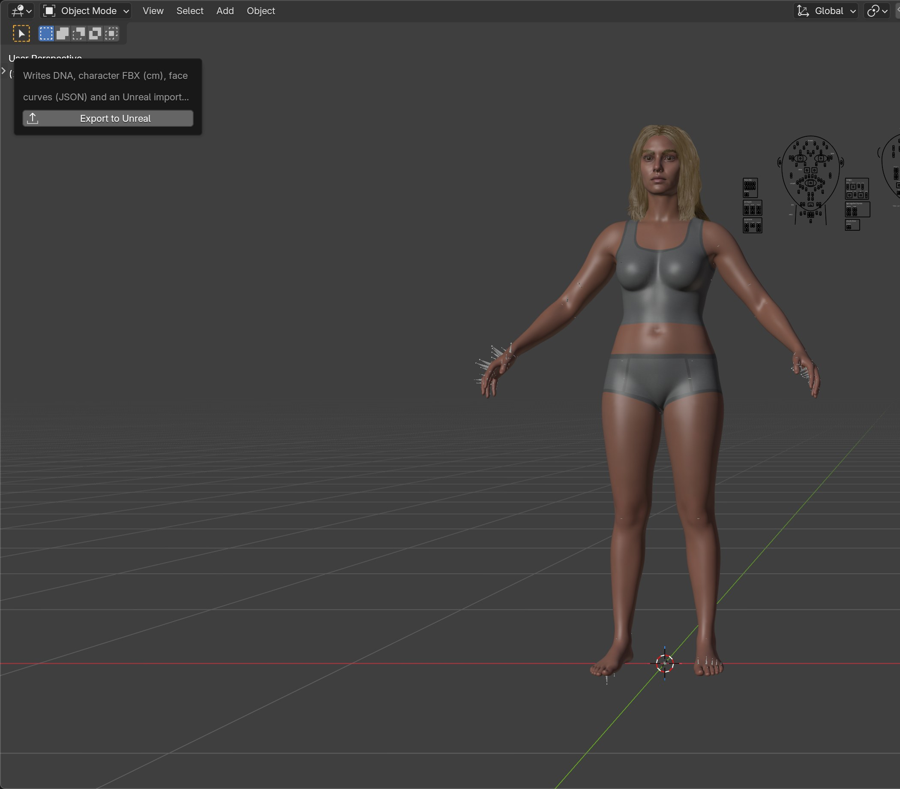

[Export to Unreal →](docs/export-to-unreal.md)

## Get started

1. **Download** the installer for your system from the
   [Releases page](https://github.com/kvriel/MetaHumanForBlender/releases).
   - **Windows:** run `MetaHuman-for-Blender-<version>-Setup.exe` and tick the Blender versions to
     install into.
   - **macOS:** unzip `MetaHuman-for-Blender-<version>-macOS.zip` and double-click
     **Install MetaHuman for Blender.command**.
   - **Any platform:** drag `MetaHuman-for-Blender-<version>.zip` into Blender.
2. **Export your MetaHumans** from MetaHuman Creator with *Export to DCC* (Unreal Engine 5.6 or
   newer).
3. **Open Blender**, press **N** and pick the **MetaHuman** tab, or use the **MetaHuman** menu in
   the top bar.

You need Blender 4.2 or newer. The [how-to guide](docs/HOW_TO_USE.md) walks you through every tool,
step by step.

## Free and open source

MetaHuman for Blender is free, under the [GPL-3.0-or-later](LICENSE), the same licence as Blender.
Use it, change it and share it. Anything you distribute that is built on it must be GPL too.

The add-on doesn't include any characters, DNA files or textures: you bring your own MetaHumans,
covered by their own licence from Epic Games.

Found a bug or have an idea? Open an
[issue](https://github.com/kvriel/MetaHumanForBlender/issues).
