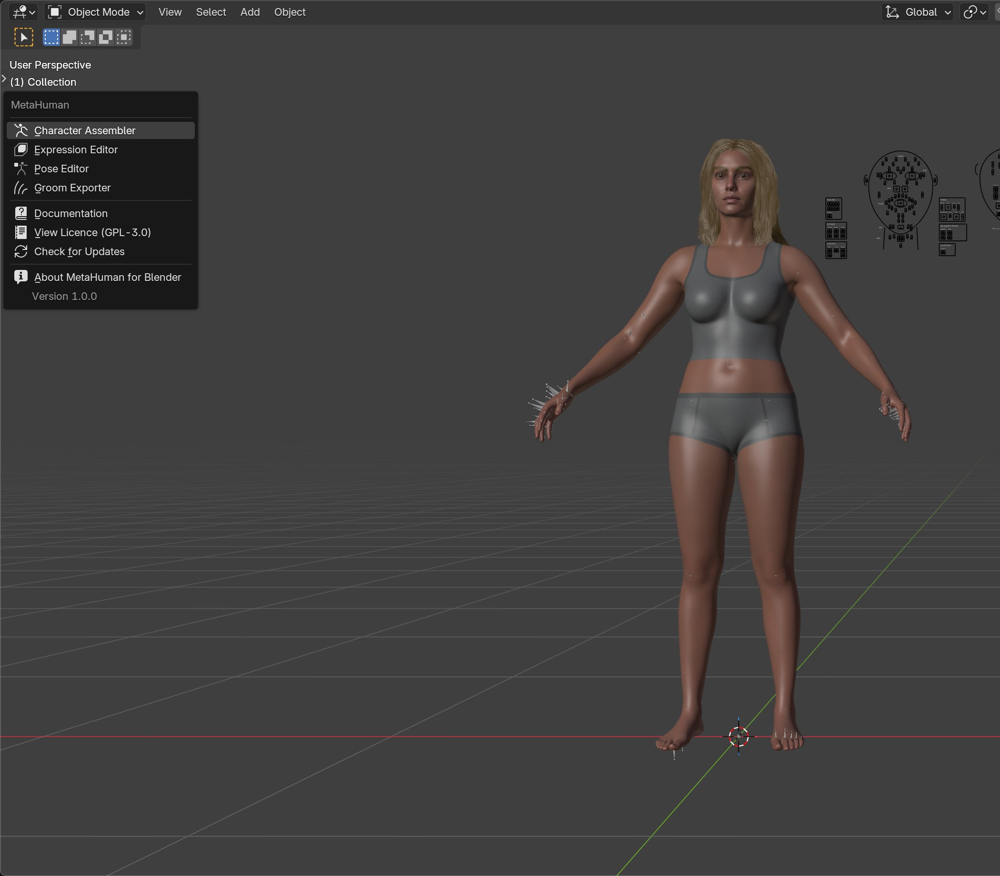

# How to use MetaHuman for Blender

This guide walks through the tools in the order you would normally use them: bring a MetaHuman into
Blender, animate and edit it, then send it back to Unreal Engine 5. Each tool has its own page:

1. [**Character Assembler**](character-assembler.md): bring a MetaHuman into Blender, with a live
   face and body rig.
2. [**Face Rig**](face-rig.md): animate the face with the face board or the raw control curves.
3. **Expression Editor**, one page per tab:
   - [**Neutral Pose**](neutral-pose.md): reshape the face at rest; joints and lower LODs follow.
   - [**Expression Poses**](expression-poses.md): change how each expression moves the face.
   - [**Skin Weights**](skin-weights.md): paint how much each face joint moves the skin.
   - [**Joints Matching**](joints-matching.md): fit the joints to the face, and copy joint motion
     between expressions.
4. [**Pose Editor**](pose-editor.md): fix body and neck deformation with RBF corrective poses.
5. [**Groom Exporter**](groom-exporter.md): export hair as Alembic grooms for Unreal.
6. [**Export to Unreal**](export-to-unreal.md): send the DNA, the character FBX and the face
   animation back to Unreal.

## Before you start

You need:

- **Blender 4.2 or newer.** It is tested on Blender 5.3.
- **MetaHumans exported from MetaHuman Creator** with *Export to DCC* (UE 5.6 or newer). Each
  character is a folder holding `head.dna`, `body.dna`, a `Maps` folder with textures, and a
  picture. Put all the character folders in one folder, your *MetaHumans directory*.
- **For the round trip to Unreal:** Unreal Engine 5.6 or newer with Epic's MetaHuman plugins. The
  face is driven by the MetaHuman face post-process anim blueprint.

The add-on comes without any characters, DNA files or textures. You use your own, under Epic's
MetaHuman licence.

## Install

1. Download `MetaHuman-for-Blender-<version>.zip` from the
   [Releases page](https://github.com/kvriel/MetaHumanForBlender/releases), or the installer
   for Windows or macOS from the same page.
2. With the zip: in Blender, go to **Edit → Preferences → Get Extensions**, open the **⌄** menu at
   the top right, choose **Install from Disk** and pick the zip. You can also drag the zip into
   the Blender window.
3. With an installer: run it, tick the Blender versions to install into, and restart Blender if it
   was open.

## Where the tools are

- **Sidebar:** in the 3D Viewport press **N** and open the **MetaHuman** tab. It has a panel for
  each tool.
- **Top-bar menu:** the **MetaHuman** menu opens each tool as a floating panel. It also has the
  built-in guide (**Documentation**), the add-on's licence, **Check for Updates** and **About**.
- **Preferences:** **Edit → Preferences → Add-ons → MetaHuman for Blender** holds the
  MetaHumans directory, an optional update URL, and environment checks that show whether
  Blender and numpy are suitable.

## Not included

- **Machine-learning joint matching:** it needs Epic's model, which cannot be redistributed.
- **Upgrading an MH.4 rig to the MH.6 rig definition:** it needs Epic's MH.6 template and rig
  definition files. Upgrading the DNA *file format* to version 2.5 is included (**Upgrade DNA
  File** in the [Pose Editor](pose-editor.md)).

## Getting help

**MetaHuman → About** shows your version and environment checks. **Copy Details** copies them to
the clipboard, ready to paste into a bug report on the
[issues page](https://github.com/kvriel/MetaHumanForBlender/issues).
