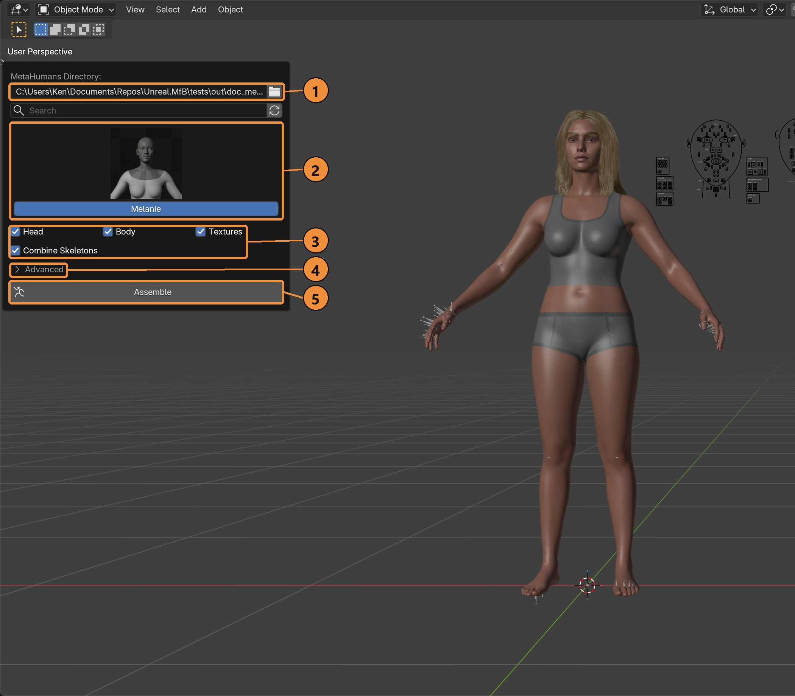

# Character Assembler

*Part of the [MetaHuman for Blender guide](HOW_TO_USE.md). Next: [Face Rig](face-rig.md).*

The Character Assembler brings a MetaHuman into Blender: it builds the rig, the meshes and the
materials from the character's DNA files.

**Open it:** in the 3D Viewport press <kbd>N</kbd>, open the **MetaHuman** tab and expand
**Character Assembler**. Or use the **MetaHuman** menu in the top bar → **Character Assembler**,
which opens it as a floating panel. Work in **Object Mode**.

## Build a character, step by step

1. **Set the MetaHumans Directory** to the folder that holds your exported characters, one folder
   per character. Blender remembers it between sessions. A single character's folder works too.
2. **Click the character's picture.** Type in **Filter** to narrow a long list, and click the
   refresh button next to it (**Refresh Characters**) after you add a new export.
3. **Choose what to build:**
   - **Head** and **Body**: one or both halves.
   - **Textures**: materials with the character's maps, including the wrinkle maps.
   - **Combine Skeletons**: one armature for head and body. With it off you get two armatures,
     `<name>_head_rig` and `<name>_body_rig`, and the head follows the body.
     **Turn it on if you plan to use [Export to Unreal](export-to-unreal.md):** with two
     armatures, Export to Unreal finds only the body.
4. **Open Advanced** if you need more control:
   - Set the DNA and texture paths by hand, or use **Load MetaHuman Folder**.
   - Choose the name, which LODs to build, and single meshes.
   - Switch blend shapes, the face board, materials or the light rig on or off.
   - Build into a new scene, or choose the scene units.
5. **Click Assemble.** The status bar says *Assembled &lt;name&gt;: &lt;N&gt; meshes in &lt;t&gt;s*.

> **Tip:** save your .blend file before you edit the character with the Expression Editor or the
> Pose Editor. Their changes go into a working copy of the DNA next to the .blend file; with an
> unsaved file it lands in Blender's temporary folder.

## What you get

- **The armature:** the face joints are in a hidden bone collection called *Face Joints*.
- **The meshes:** with shape keys and skin weights.
- **Materials:** with wrinkle maps.
- **The face board and eye aim controls.**
- **A live rig:** RigLogic drives the face and body, including the correctives and twist joints,
  so the character moves the way it does in Unreal.

## If something doesn't work

- **Assemble is greyed out.** Switch to Object Mode, and make sure **Head** or **Body** is ticked
  with a DNA file found for it. The tick boxes stay greyed out while their file is missing.
- **"No MetaHumans in this folder".** The directory must hold the character folders directly
  (`MetaHumans/Melanie/head.dna`), not deeper. Each character folder needs a `.dna` file or an
  `ExportManifest.json` at its top level.
- **"&lt;file&gt; looks like a body DNA, not a head DNA"** (or the other way round). A file is in the
  wrong slot: open **Advanced** and swap the Head DNA and Body DNA paths.
- **"… is not a DNA file"** or **"… uses DNA file version …; only 2.2 to 2.5 are supported".**
  Export the character again from MetaHuman Creator with *Export to DCC* (UE 5.6 or newer).
- **The character's picture is missing.** The gallery uses `<name>.png`, `<folder>.png`,
  `thumbnail.png` or `preview.png` from the character folder; the character still builds without one.

Next, animate the face with the [Face Rig](face-rig.md).
