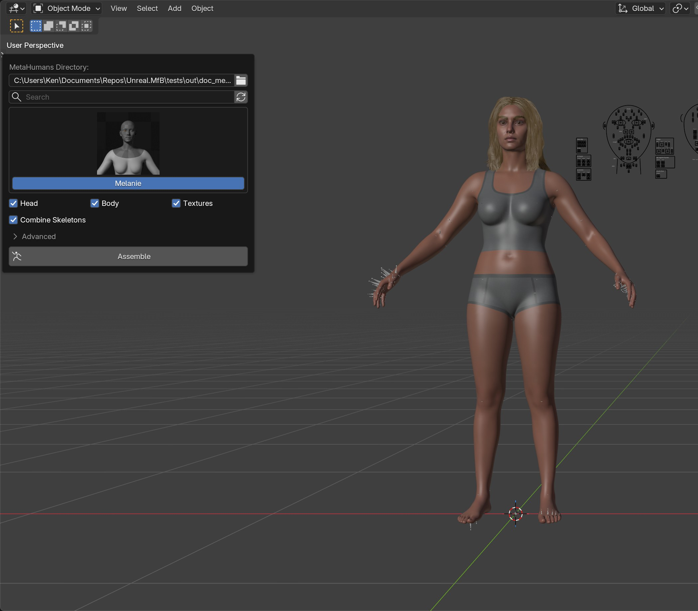

# Character Assembler

*Part of the [MetaHuman for Blender guide](HOW_TO_USE.md). Next: [Face Rig](face-rig.md).*

The Character Assembler brings a MetaHuman into Blender: it builds the rig, the meshes and the
materials from the character's DNA files.

## Build a character

1. Open the **Character Assembler** panel.
2. Set **MetaHumans Directory** to the folder with your exported characters. Blender remembers it
   between sessions. A single character's folder works too.
3. Click a character's picture in the grid. Type in **Filter** to narrow a long list, and use
   **Refresh Characters** after you add a new export.
4. Choose what to build:
   - **Head** and **Body**: one or both halves.
   - **Textures**: materials with the character's maps, including the wrinkle maps.
   - **Combine Skeletons**: one armature for head and body. With it off you get two armatures,
     and the head follows the body.
5. Open **Advanced** if you need more control:
   - Set the DNA and texture paths by hand, or use **Load MetaHuman Folder**.
   - Choose the name, which LODs to build, and single meshes.
   - Switch blend shapes, the face board, materials or the light rig on or off.
   - Build into a new scene, or choose the scene units.
6. Click **Assemble**.

## What you get

- **The armature:** the face joints are in a hidden bone collection called *Face Joints*.
- **The meshes:** with shape keys and skin weights.
- **Materials:** with wrinkle maps.
- **The face board and eye aim controls.**
- **A live rig:** RigLogic drives the face and body, including the correctives and twist joints,
  so the character moves the way it does in Unreal.

Next, animate the face with the [Face Rig](face-rig.md).
