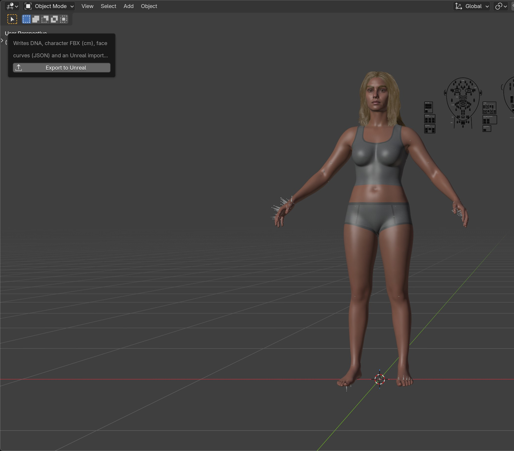

# Export to Unreal

*Part of the [MetaHuman for Blender guide](HOW_TO_USE.md). Previous: [Groom Exporter](groom-exporter.md).*

Export to Unreal sends the character, its DNA and its face animation back to Unreal Engine 5.



## Export

1. Open the **Export to Unreal** panel and click **Export to Unreal**.
2. Pick an output folder and choose what to write:
   - **DNA Files:** `<name>_head.dna` and `<name>_body.dna`.
   - **Character FBX:** `<name>.fbx` in centimetres, with every morph target named the way
     Unreal's RigLogic expects (`<mesh>__<channel>`).
   - **Face Animation Curves:** `<name>_face_curves.json` for the scene's frame range, plus the
     Unreal script `mfb_import_face_curves.py`.

## In Unreal

1. Import the FBX, or apply the DNA files to your MetaHuman as usual.
2. To bring the face animation across:
   1. Select an Animation Sequence in the Content Browser.
   2. In the Output Log (Python mode) or **Tools → Execute Python Script**, run:

      ```
      py "<folder>/mfb_import_face_curves.py" "<folder>/<name>_face_curves.json"
      ```

   This adds the `CTRL_expressions_*` curves to the sequence and replaces any curves of the same
   name that are already there.

With the head's DNA on the skeletal mesh and the MetaHuman face post-process anim blueprint on it,
Unreal's RigLogic turns those curves into the same face as in Blender.

## Level of detail

Unreal runs RigLogic at the mesh's display LOD. The template head has blend shapes only at LOD 0
and wrinkle maps only at LODs 0 and 1, so a head far from the camera loses them.
