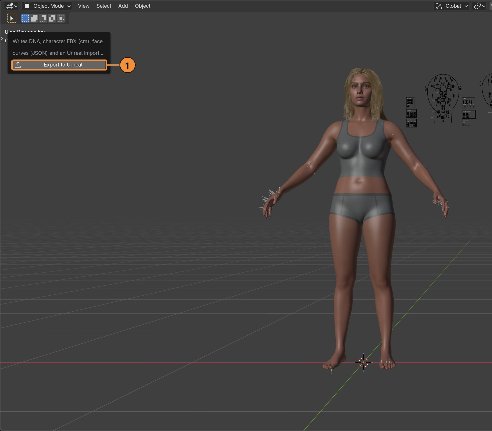

# Export to Unreal

*Part of the [MetaHuman for Blender guide](HOW_TO_USE.md). Previous: [Groom Exporter](groom-exporter.md).*

Export to Unreal sends the character, its DNA and its face animation back to Unreal Engine 5.

**Open it:** in the 3D Viewport press <kbd>N</kbd>, open the **MetaHuman** tab and expand
**Export to Unreal**. It is in the sidebar only, not in the top-bar menu.

**Before you export:**

- Have **one character** in the file. The export takes the first assembled rig, by name.
- Build it with **Combine Skeletons** on in the [Character Assembler](character-assembler.md).
  With two armatures (`_body_rig` and `_head_rig`), the export finds the body rig first and writes
  no head DNA and no face animation.
- Set the scene's **frame range** to the animation you want: it is what the face curves cover.



## Export, step by step

1. **Click Export to Unreal.** A file browser opens. Nothing needs to be selected first.
2. **Choose what to write** in the file browser's side panel (open it with the gear button, or
   <kbd>N</kbd>, if it is hidden):
   - **DNA Files:** `<name>_head.dna` and `<name>_body.dna`, with your Expression Editor and
     Pose Editor changes.
   - **Character FBX:** `<name>.fbx` in centimetres, every mesh and LOD, with every morph target
     named the way Unreal's RigLogic expects (`<mesh>__<channel>`).
   - **Face Animation Curves:** `<name>_face_curves.json`, plus the Unreal script
     `mfb_import_face_curves.py`. **Start** and **End** set the frames; -1 uses the scene's range.
3. **Pick the output folder and click Export to Unreal** at the bottom right. The status bar says
   *Wrote … to …*.

## In Unreal

1. Import the FBX, or apply the DNA files to your MetaHuman as usual.
2. To bring the face animation across:
   1. Select an Animation Sequence in the Content Browser.
   2. In the Output Log (Python mode) or **Tools → Execute Python Script**, run:

      ```
      py "<folder>/mfb_import_face_curves.py" "<folder>/<name>_face_curves.json"
      ```

   This adds the `CTRL_expressions_*` curves to the sequence and replaces any curves of the same
   name that are already there.

With the head's DNA on the skeletal mesh and the MetaHuman face post-process anim blueprint on it,
Unreal's RigLogic turns those curves into the same face as in Blender.

## Level of detail

Unreal runs RigLogic at the mesh's display LOD. The template head has blend shapes only at LOD 0
and wrinkle maps only at LODs 0 and 1, so a head far from the camera loses them.

## If something doesn't work

- **"No assembled character found".** Assemble the character with the
  [Character Assembler](character-assembler.md) first.
- **No head DNA, no `_face_curves.json`, or only body meshes.** The character has two armatures:
  assemble it again with **Combine Skeletons** on.
- **The wrong character was exported.** The export takes the first assembled rig by name: export
  from a file with only that character.
- **The face animation is too short.** Set **Start** and **End**, or the scene's frame range,
  before exporting.
