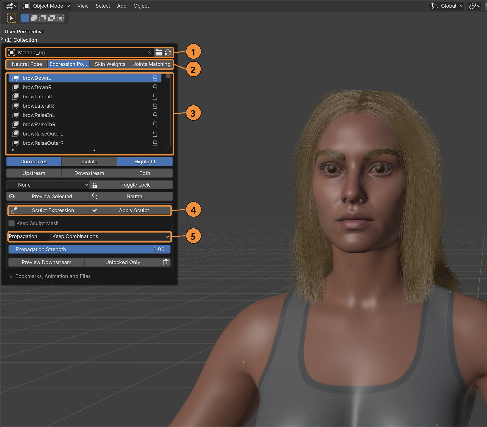

# Expression Poses

*Part of the [MetaHuman for Blender guide](HOW_TO_USE.md), Expression Editor. Previous: [Neutral Pose](neutral-pose.md). Next: [Skin Weights](skin-weights.md).*

The **Expression Poses** tab of the Expression Editor changes how an expression moves the face:
how far the brows lift, how the lips purse, how the cheeks fold in a smile.

**Open it:** in the 3D Viewport press <kbd>N</kbd>, open the **MetaHuman** tab and expand
**Expression Editor**, or use the **MetaHuman** menu in the top bar → **Expression Editor**.
Save your .blend file first: your changes go into a working copy of the DNA next to it.

The Expression Editor has four tabs; the others have their own pages:
[Neutral Pose](neutral-pose.md), [Skin Weights](skin-weights.md) and
[Joints Matching](joints-matching.md).

## Change an expression, step by step

1. **Pick the character's rig** in the field at the top, then click the refresh button at its
   right (**Refresh Expressions**) to fill the list.
2. **Open the Expression Poses tab.**
3. **Pick an expression** in the list, for example `browDownL`. **Preview Selected** shows it on
   the face; **Neutral** returns the face to rest.
4. **Sculpt it:**
   1. Click **Sculpt Expression.** You get a new object, `SCULPT_<expression>`, a copy of the head
      in that expression. The head itself is hidden meanwhile.
   2. Select `SCULPT_<expression>` in the Outliner and switch to **Sculpt Mode** (the new object
      isn't selected for you).
   3. Sculpt the change, then **go back to Object Mode.**
   4. Click **Apply Sculpt.** The change becomes the expression's corrective shape, the sculpt
      object is deleted (tick **Keep Sculpt Mesh** to keep it) and the head comes back.
5. **Before you apply, choose the Propagation.** It decides what happens to the combination
   shapes that build on this expression:
   - **Keep Combinations** takes the change out of them again, so combined poses look the same as
     before;
   - **Carry Into Combinations** leaves them alone, so the change shows in every combination.

   **Propagation Strength** sets how much of the change Keep Combinations takes out. Expressions
   you lock with **Toggle Lock** are never changed.

When you're done, click **Face Board** in the [Face Rig](face-rig.md) panel: these buttons switch
the face to Raw Attributes, so the board doesn't drive the face until you do.

## Working with the expression graph

Expressions build on each other: a combination shape such as a smile with the jaw open depends on
the smile and on the open jaw.

- **Correctives** shows the combination shapes in the list too.
- **Upstream**, **Downstream** and **Both** mark the expressions the selected one depends on, the
  ones that depend on it, or both. **Isolate** then shows only that branch in the list, and
  **Highlight** picks out the expression you selected last. The colour menu next to **Toggle Lock**
  gives an expression a colour of its own.
- **Preview Selected** shows the selected expression on the face, with every other control at
  zero; **Neutral** returns the face to rest.
- **Preview Downstream** makes preview meshes (`PREVIEW_<name>`, in the `MFB_Previews`
  collection) of up to 24 combination shapes that depend on the selected expression
  (**Unlocked Only**: just the unlocked ones); the bin button deletes them.

## Bookmarks, Animation and Files

- Save groups of expressions as **Bookmarks**. Eye and full-face presets are included.
- Make a **Range-of-Motion Animation** to check every expression.
- Save and load a **Settings File**.

## Saving your work

- Your changes go into the working copy of the DNA next to your .blend file (`<name>_edit.dna`),
  which the live rig reads.
- **Save MetaHuman DNA** writes them to a DNA file of your own: set **File** to a path ending in
  `.dna` first.
- **Export FBX** writes the head as Y-up or Z-up, to a **File** path ending in `.fbx`.

To use the new DNA in Unreal, see [Export to Unreal](export-to-unreal.md).

## If something doesn't work

- **The buttons are greyed out** and the panel says *Load or pick an assembled head*. Pick the
  rig at the top (step 1).
- **The list is empty, or a button gives a Python error.** Click the refresh button next to the
  rig picker so the list fills, and select an expression in it.
- **"Make a sculpt mesh first".** Click **Sculpt Expression** before **Apply Sculpt**.
- **Apply Sculpt applied the wrong sculpt.** It uses the first `SCULPT_…` object in the scene.
  Delete sculpt meshes you kept from earlier (**Keep Sculpt Mesh**) before sculpting the next one.
- **The sculpt didn't take.** Go back to Object Mode before you click **Apply Sculpt**.
- **The face stays in an expression, and the board doesn't move it.** Click **Neutral**, then
  **Face Board** in the Face Rig panel.
- **"Set File to a .dna path"** (or *.fbx path*). Fill in **File** under *Bookmarks, Animation
  and Files* with the right extension.
