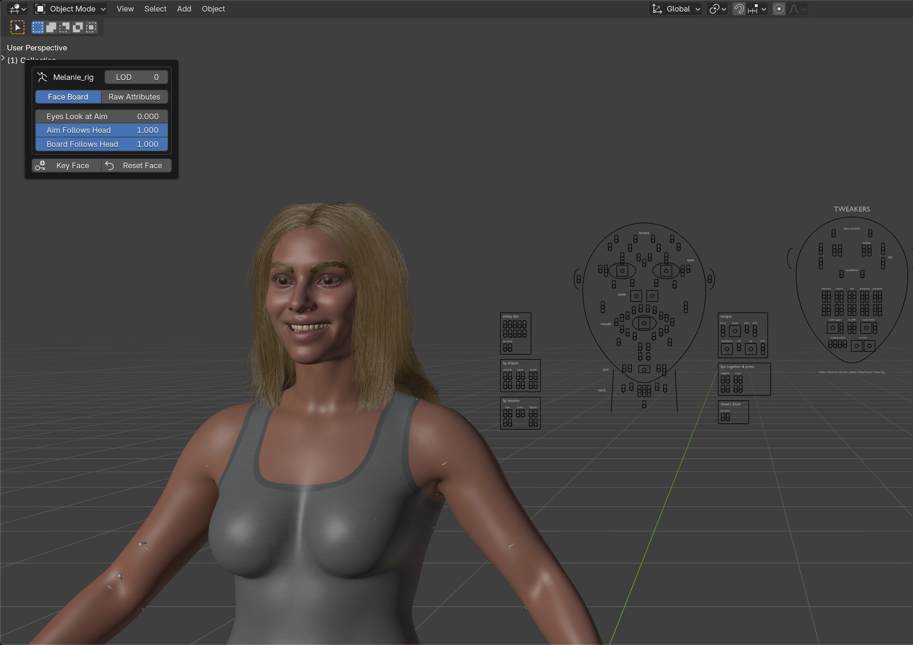
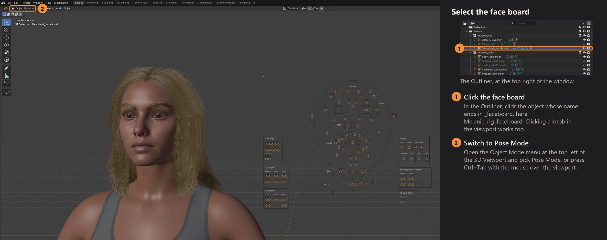
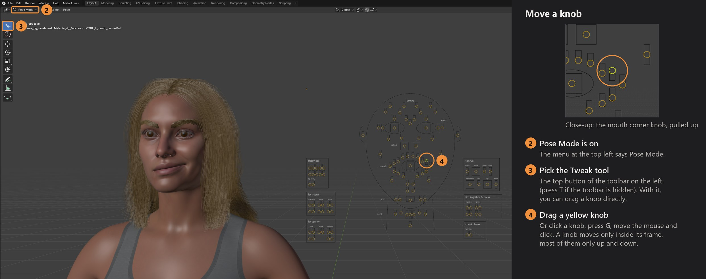
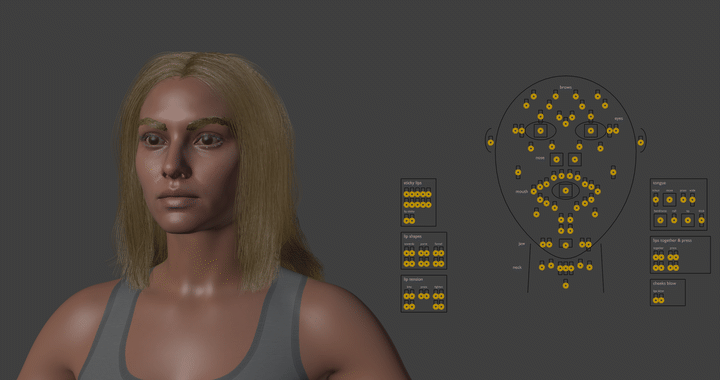
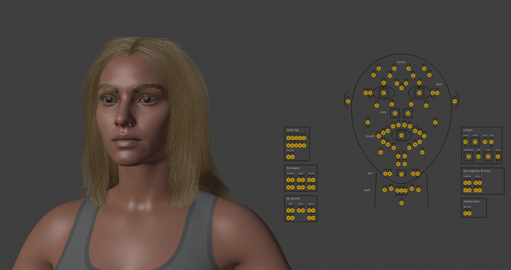
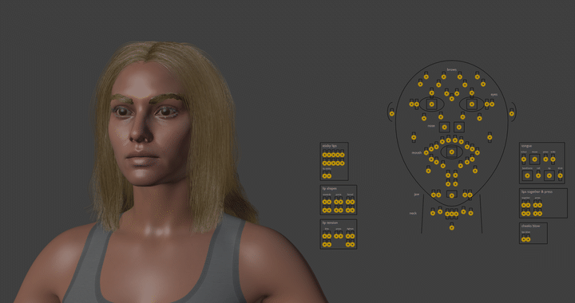
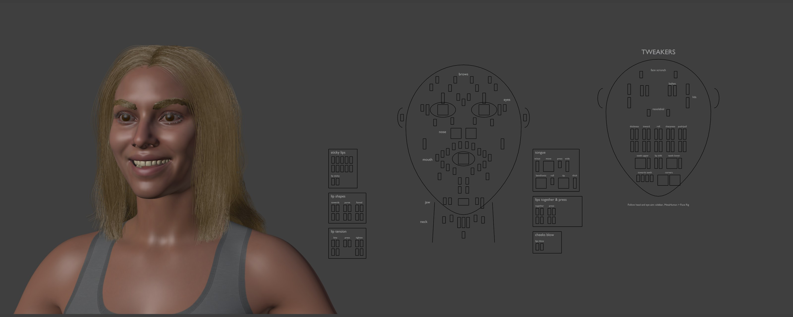

# Face Rig

*Part of the [MetaHuman for Blender guide](HOW_TO_USE.md). Previous: [Character Assembler](character-assembler.md). Next: [Neutral Pose](neutral-pose.md).*

The **Face Rig** panel controls how you drive the face of an [assembled character](character-assembler.md).

**Open it:** in the 3D Viewport press <kbd>N</kbd>, open the **MetaHuman** tab and expand
**Face Rig**. It is in the sidebar only, not in the top-bar menu.

## Face Board or Raw Attributes

Each rig in the file has a row with two buttons:

- **Face Board:** you animate the knobs on the board beside the head. This is the normal choice.
- **Raw Attributes:** you animate the control attributes on `FACIAL_C_FacialRoot` directly.
  These are the same curves Unreal reads.

Only one of them drives the face at a time. If you move a knob and the face doesn't follow, check
that **Face Board** is chosen here (see [below](#if-something-doesnt-work)).

## Move the face with the board, step by step

The face board is its own object, an armature named after the rig with `_faceboard` at the end,
such as `Melanie_rig_faceboard`. Each yellow knob is one of its bones, so you move the knobs in
**Pose Mode**.

1. **Select the board.** In the **Outliner** (top right of the window), click the object whose
   name ends in `_faceboard`. You can also click one of its knobs in the viewport while you are in
   Object Mode.
2. **Switch to Pose Mode.** Open the **Object Mode** menu at the top left of the 3D Viewport and
   pick **Pose Mode**, or press <kbd>Ctrl</kbd>+<kbd>Tab</kbd> with the mouse over the viewport.
   If Pose Mode isn't in the menu, the active object is a mesh, not the board: go back to step 1.

3. **Pick the Tweak tool,** the top button of the toolbar on the left of the viewport (press
   <kbd>T</kbd> if the toolbar is hidden). With the default *Select Box* tool, dragging draws a
   selection box instead of moving a knob.
4. **Drag a yellow knob.** Or click a knob, press <kbd>G</kbd>, move the mouse and click to
   confirm. Each knob moves only inside its frame, and most of them only up and down; the square
   ones (eyes, jaw, mouth) also move sideways.
5. **Key it.** Click **Key Face** in the Face Rig panel to key every knob and the eye aim at the
   current frame, or select knobs and press <kbd>I</kbd>. Scrub the timeline to play it back.

| Eyes | Surprise | Frown |
|:---:|:---:|:---:|
|  |  |  |
| The eye and blink knobs | Brows, eyes and jaw | Brows, nose and mouth corners |

The wrinkle maps switch on by themselves as the expression changes (in Material Preview or
Rendered view).

## The board's layout

- **Main board:** shaped like a face. Each knob sits over the part of the face it moves: brows,
  eyes, nose, mouth, jaw and neck.
- **Left panels:** sticky lips, lip shapes (towards, purse, funnel) and lip tension (bite, press,
  tighten).
- **Right panels:** the tongue, lips together and press, and cheeks blow.
- **TWEAKERS head:** the fine controls, such as face scrunch, eyelids, nasolabial folds, lip
  thickness and roll, teeth and the mouth corners.
- **Limits:** each knob's frame shows how far it can move.

## The other controls

- **Eyes Look at Aim:** points the eyes at the aim control (0 = off, 1 = fully on).
- **Board Follows Head / Aim Follows Head:** keeps the board and the aim with the head as it turns.
- **Key Face:** sets a keyframe on every face control at the current frame: the board knobs and
  the eye aim, or the raw attributes in Raw Attributes mode.
- **Reset Face:** returns every board knob to neutral. It doesn't change the raw attributes.

## Coming from Maya?

The board has the same layout and control names as in Maya, and moving a knob drives the face the
same way. Selecting a knob works differently:

| | Maya | Blender |
|---|---|---|
| A knob is | its own curve object | a bone of the `_faceboard` armature |
| Before you can pick a knob | nothing: click it | select the board, switch to Pose Mode |
| Move it | Move tool (<kbd>W</kbd>) or middle-mouse drag | Tweak tool and drag, or <kbd>G</kbd> |
| Key it | <kbd>S</kbd> | <kbd>I</kbd>, or **Key Face** |

## If something doesn't work

- **Dragging a knob draws a box instead.** The *Select Box* tool is active: pick the **Tweak**
  tool (step 3) or use <kbd>G</kbd>.
- **Clicking a knob selects the whole board, and it moves as one piece.** You are in Object Mode:
  switch to Pose Mode (step 2). Press <kbd>Ctrl</kbd>+<kbd>Z</kbd> if you moved the board.
- **The knob moves, but the face doesn't.**
  - The face is set to **Raw Attributes.** Click **Face Board** in the Face Rig panel. The
    [Expression Editor](expression-poses.md) switches the face to Raw Attributes when you use
    **Preview Selected**, **Neutral**, **Sculpt Expression** or **Apply Sculpt**, or make a
    range-of-motion animation, and it doesn't switch back by itself.
  - The **[Pose Editor](pose-editor.md) is editing a face (neck) pose.** The face rig pauses
    while it edits: click **Finish Editing** there.
  - The board was renamed or deleted. Assemble the character again to get a new one.
- **The knob won't move one way.** It is at the edge of its frame, or that knob only moves up and
  down.
- **You see two rigs in the panel.** With **Combine Skeletons** off, the body rig is listed too;
  use the buttons on the head rig's row.

To bring the animation into Unreal, see [Export to Unreal](export-to-unreal.md).
