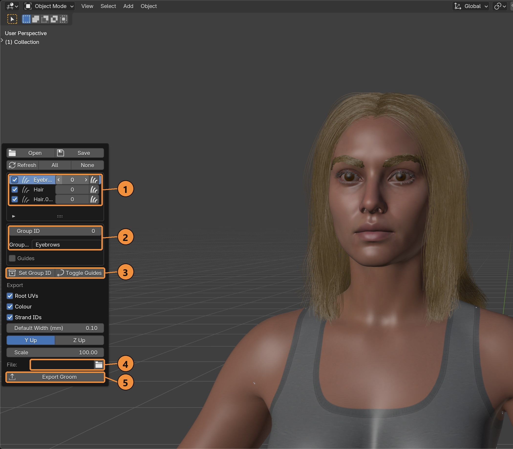

# Groom Exporter

*Part of the [MetaHuman for Blender guide](HOW_TO_USE.md). Previous: [Pose Editor](pose-editor.md). Next: [Export to Unreal](export-to-unreal.md).*

The Groom Exporter writes Blender hair to Alembic files that Unreal imports as grooms.

**Open it:** in the 3D Viewport press <kbd>N</kbd>, open the **MetaHuman** tab and expand
**Groom Exporter**, or use the **MetaHuman** menu in the top bar → **Groom Exporter**.

The hair must be **Curves** objects, Blender's hair type (**Add → Curves**, then the hair tools).
Old particle-system hair and other curve types aren't listed: convert them to Curves first.

## Export hair, step by step

1. **Click Refresh** to list the hair Curves objects in the scene, and **tick the ones to export**
   (**All** and **None** tick them all or none). Click Refresh again after you add hair.
2. **Name each groom:** click a row and set its **Group ID** and **Group Name** below the list.
   Hair with the same group ID becomes one groom group in Unreal.
3. **Set Group ID** gives one ID to every *ticked* row at once. **Toggle Guides** marks the
   selected row as guide curves (rows with "guide" in the name start as guides).
4. **Set File** to where the Alembic file goes. Left empty, it writes `groom.abc` next to the
   .blend file.
5. **Click Export Groom.** It writes the hair as it is at the current frame, in centimetres and
   Y-up by default (**Scale** 100), with the attributes Unreal's groom importer expects. The
   status bar says how many strands and grooms it wrote.

**Save** and **Open** at the top store and reload all these settings as a preset.

## Guides

Guides must share a group ID with the hair they guide. Unreal does not import a group that holds
only guides, so the exporter refuses to write one.

With **Z Up** instead of Y Up, set the import rotation to 0 in Unreal's groom import options.

## If something doesn't work

- **The list is empty, or your hair is missing.** Click **Refresh.** Only Curves objects are
  listed: convert particle hair to Curves first.
- **"No grooms chosen for export".** Tick at least one row in the list.
- **"Group ID … has only guide curves".** Give the guides the same group ID as the hair they
  guide.
- **"&lt;object&gt;: no radius attribute, using 0.10 mm".** The hair has no width of its own; set
  **Default Width (mm)** to the width you want.
- **"… no surface with UVs, root UVs set to 0".** Give the hair a surface mesh with UVs (the hair
  tools' *Surface* setting) if you need root UVs in Unreal.
- **"Not in this scene: …" after Open.** The preset names hair objects this scene doesn't have;
  the rest of the preset is still applied.
