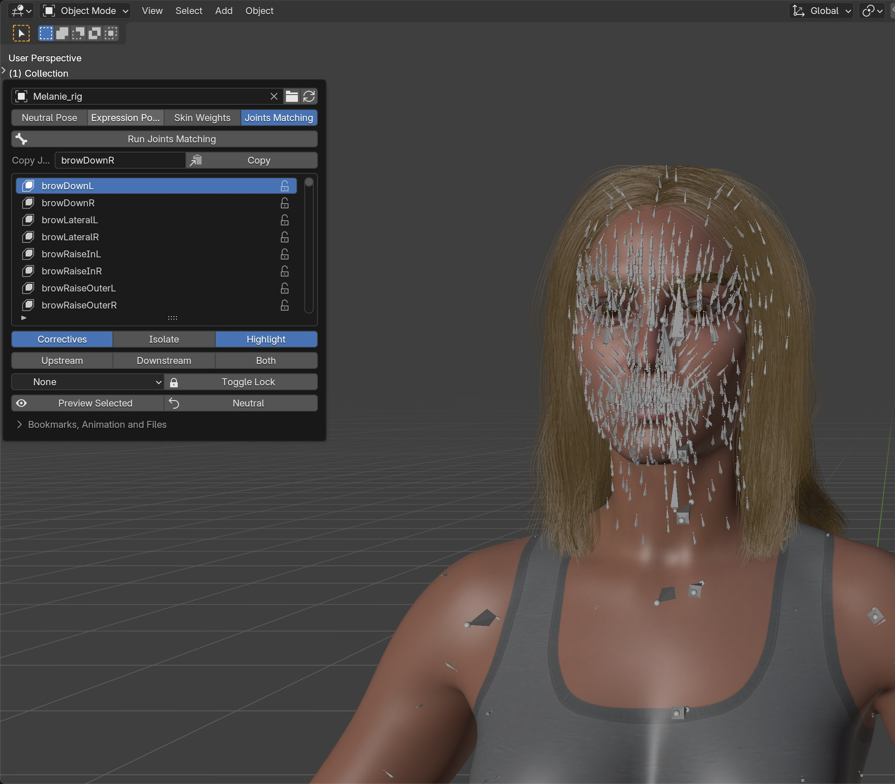

# Joints Matching

*Part of the [MetaHuman for Blender guide](HOW_TO_USE.md), Expression Editor. Previous: [Skin Weights](skin-weights.md). Next: [Pose Editor](pose-editor.md).*

The **Joints Matching** tab of the Expression Editor keeps the face joints in step with the face:
it fits the joints to a reshaped neutral face, and copies joint motion from one expression to
another.

## Fit the joints to the face

Click **Run Joints Matching**. It compares the head's neutral face now with the face in the DNA you
assembled, and moves every face joint to follow its part of the skin. The status line says how
many joints moved.

Use it when:

- you reshaped the face on the [Neutral Pose](neutral-pose.md) tab with **Match Joints** off;
- you changed the [skin weights](skin-weights.md) a lot after reshaping;
- the neutral face changed some other way, for example in a DNA file you loaded.

### How joints are matched

Each joint moves by the average movement of the vertices it skins. Vertices count more the more
weight the joint has on them (the weight is squared), and weights under 0.05 are left out. A joint
that skins no vertices follows its skinned child joints, or else its parent. The joints keep their
orientation; only their positions change.

## Copy joint motion between expressions

1. Pick the source expression in the list, for example `browDownL`.
2. Type the target expression's name in **Copy Joints To**, for example `browDownR`.
3. Click **Copy**.

The target's joint motion is replaced by the source's, joint for joint. The motion is copied as it
is, not mirrored. The status line says how many joints were copied; if no expression has the
target's name, nothing changes and you get an error.

## Not included

Epic's machine-learning joint matching needs Epic's model, which can't be redistributed. The
matching here is the least-squares fit described above.
