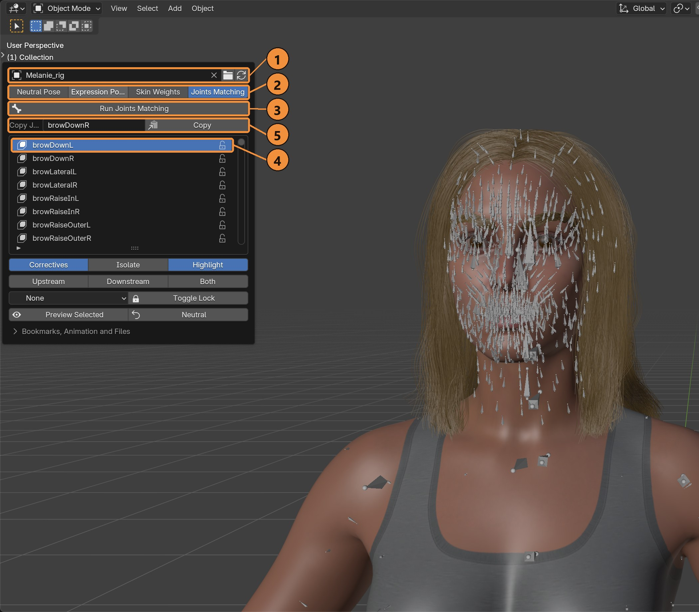

# Joints Matching

*Part of the [MetaHuman for Blender guide](HOW_TO_USE.md), Expression Editor. Previous: [Skin Weights](skin-weights.md). Next: [Pose Editor](pose-editor.md).*

The **Joints Matching** tab of the Expression Editor keeps the face joints in step with the face:
it fits the joints to a reshaped neutral face, and copies joint motion from one expression to
another.

**Open it:** in the 3D Viewport press <kbd>N</kbd>, open the **MetaHuman** tab and expand
**Expression Editor**, or use the **MetaHuman** menu in the top bar → **Expression Editor**.
Save your .blend file first: your changes go into a working copy of the DNA next to it.

## Fit the joints to the face

1. **Pick the character's rig** in the field at the top, and click the refresh button at its
   right to fill the expression list.
2. **Open the Joints Matching tab.**
3. **Click Run Joints Matching.** It compares the head's neutral face now with the face in the DNA
   you assembled, and moves every face joint to follow its part of the skin. The status line says
   how many joints moved.

Run it **once** after a change, when:

- you reshaped the face on the [Neutral Pose](neutral-pose.md) tab with **Match Joints** off;
- the neutral face changed some other way, for example in a DNA file you loaded.

You don't need it after **Apply Neutral** with **Match Joints** on: that already matched the
joints. Each run moves the joints by the whole difference again, so running it twice moves them
twice: press <kbd>Ctrl</kbd>+<kbd>Z</kbd> if that happens.

### How joints are matched

Each joint moves by the average movement of the vertices it skins. Vertices count more the more
weight the joint has on them (the weight is squared), and weights under 0.05 are left out. A joint
that skins no vertices follows its skinned child joints, or else its parent. The joints keep their
orientation; only their positions change.

## Copy joint motion between expressions

With the rig picked and the Joints Matching tab open (steps 1 and 2):

**4 · Pick the source expression** in the list, for example `browDownL`.

**5 · Type the target expression's name** in **Copy Joints To**, for example `browDownR`, exactly
as it is in the list (capitals count), and click **Copy**.

The target's joint motion is replaced by the source's, joint for joint. The motion is copied as it
is, not mirrored. The status line says how many joints were copied.

## If something doesn't work

- **The buttons are greyed out** and the panel says *Load or pick an assembled head*. Pick the
  rig at the top (step 1).
- **Run Joints Matching moves nothing.** The neutral face hasn't changed yet: reshape it on the
  [Neutral Pose](neutral-pose.md) tab and click **Apply Neutral** first.
- **"No expression named '…'".** The name in **Copy Joints To** doesn't match an expression in the
  list exactly; check the spelling and the capitals.
- **Copy gives a Python error.** The list is empty: click the refresh button next to the rig picker
  and pick a source expression.

## Not included

Epic's machine-learning joint matching needs Epic's model, which can't be redistributed. The
matching here is the least-squares fit described above.
