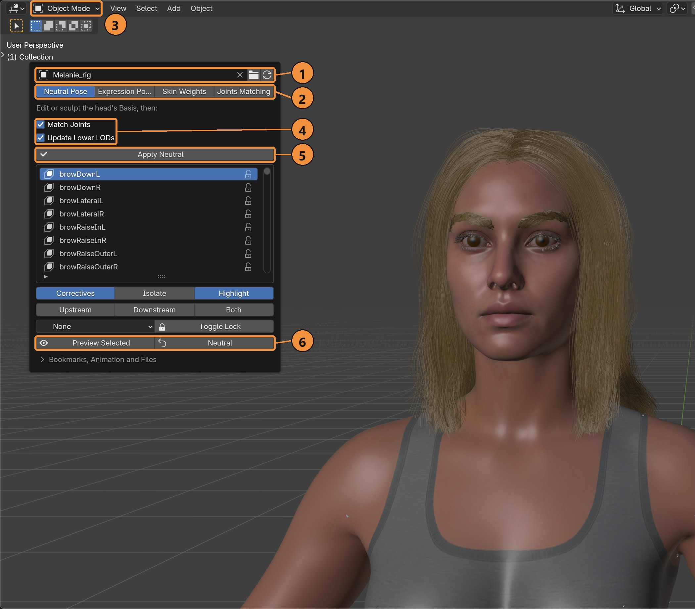

# Neutral Pose

*Part of the [MetaHuman for Blender guide](HOW_TO_USE.md), Expression Editor. Previous: [Face Rig](face-rig.md). Next: [Expression Poses](expression-poses.md).*

The **Neutral Pose** tab of the Expression Editor changes the shape of the face at rest: a wider
jaw, a longer nose, fuller lips. Every expression is built on top of the neutral face, so the
expressions follow the new shape.

**Open it:** in the 3D Viewport press <kbd>N</kbd>, open the **MetaHuman** tab and expand
**Expression Editor**, or use the **MetaHuman** menu in the top bar → **Expression Editor**.
Save your .blend file first: your changes go into a working copy of the DNA next to it.

## Reshape the face, step by step

1. **Pick the character's rig** in the field at the top (`Melanie_rig`, or `<name>_head_rig`
   with separate skeletons), then click the refresh button at its right to fill the expression
   list. The folder button loads a head DNA file instead.
2. **Open the Neutral Pose tab.**
3. **Reshape the head.** Select the head mesh (`head_lod0_mesh`), switch to **Edit Mode** or
   **Sculpt Mode** in the mode menu, and change its **Basis** shape key: move vertices, or use the
   sculpt brushes. Keep the Basis as the active shape key. Then **go back to Object Mode**:
   Blender only stores Edit Mode changes when you leave it.
4. **Choose what follows the new shape:**
   - **Match Joints** (on by default) moves the face joints with the skin, so the rig still fits
     the face. See [how joints are matched](joints-matching.md#how-joints-are-matched).
   - **Update Lower LODs** (on by default) carries the change to the lower levels of detail. Each
     vertex of a lower LOD moves by a blend of the four nearest LOD 0 vertices, weighted by how
     close they are.
5. **Click Apply Neutral.** The status line says how far the face moved and how many LODs and
   joints were updated.
6. **Check the result:** pick an expression in the list and click **Preview Selected** to see it
   on the new face, then **Neutral** to go back to rest.

When you're done checking, click **Face Board** in the [Face Rig](face-rig.md) panel: the preview
buttons switch the face to Raw Attributes, so the board doesn't drive the face until you do.

## Things to keep in mind

- Move vertices, but don't add or delete them: the DNA keeps a fixed vertex count for every mesh.
- If you reshaped with **Match Joints** off, run [Joints Matching](joints-matching.md) once
  afterwards.
- The change goes into the working copy of the DNA next to your .blend file (`<name>_edit.dna`),
  which the live rig reads. **Save MetaHuman DNA** (under *Bookmarks, Animation and Files*) writes
  it to a DNA file of your own, and [Export to Unreal](export-to-unreal.md) takes it to Unreal.

## If something doesn't work

- **The buttons are greyed out** and the panel says *Load or pick an assembled head*. Pick the
  rig in the field at the top (step 1). Only a rig with a head works: the combined rig or the
  `_head_rig`.
- **"The neutral face has not changed".** You are still in Edit Mode (switch to Object Mode and
  click again), or you changed another shape key than **Basis**, or another mesh than
  `head_lod0_mesh`.
- **The expression list is empty.** Click the refresh button next to the rig picker.
- **The face board stopped moving the face.** Click **Face Board** in the Face Rig panel.
