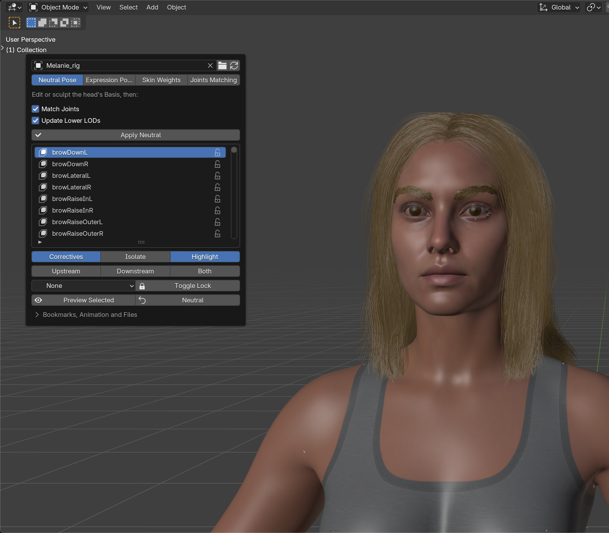

# Neutral Pose

*Part of the [MetaHuman for Blender guide](HOW_TO_USE.md), Expression Editor. Previous: [Face Rig](face-rig.md). Next: [Expression Poses](expression-poses.md).*

The **Neutral Pose** tab of the Expression Editor changes the shape of the face at rest: a wider
jaw, a longer nose, fuller lips. Every expression is built on top of the neutral face, so the
expressions follow the new shape.

## Reshape the face

1. Open the **Expression Editor** and pick the character's rig at the top (the folder button loads
   a DNA file instead). Switch to the **Neutral Pose** tab.
2. Select the head mesh (`head_lod0_mesh`) and change its **Basis** shape key: move vertices in
   Edit Mode, or use the brushes in Sculpt Mode. Keep the Basis as the active shape key while you
   work.
3. Choose what follows the new shape:
   - **Match Joints** (on by default) moves the face joints with the skin, so the rig still fits
     the face. See [how joints are matched](joints-matching.md#how-joints-are-matched).
   - **Update Lower LODs** (on by default) carries the change to the lower levels of detail. Each
     vertex of a lower LOD moves by a blend of the four nearest LOD 0 vertices, weighted by how
     close they are.
4. Click **Apply Neutral**. The status line says how far the face moved and how many LODs and
   joints were updated. If nothing changed, it says *The neutral face has not changed*.

## Check the result

- Pick an expression in the list and click **Preview Selected** to see it on the new face, then
  **Neutral** to go back to rest.
- If you reshaped with **Match Joints** off, run [Joints Matching](joints-matching.md) afterwards.

## Things to keep in mind

- Move vertices, but don't add or delete them: the DNA keeps a fixed vertex count for every mesh.
- The change goes into the working copy of the DNA next to your .blend file (`<name>_edit.dna`),
  which the live rig reads. **Save MetaHuman DNA** (under *Bookmarks, Animation and Files*) writes
  it to a DNA file of your own, and [Export to Unreal](export-to-unreal.md) takes it to Unreal.
