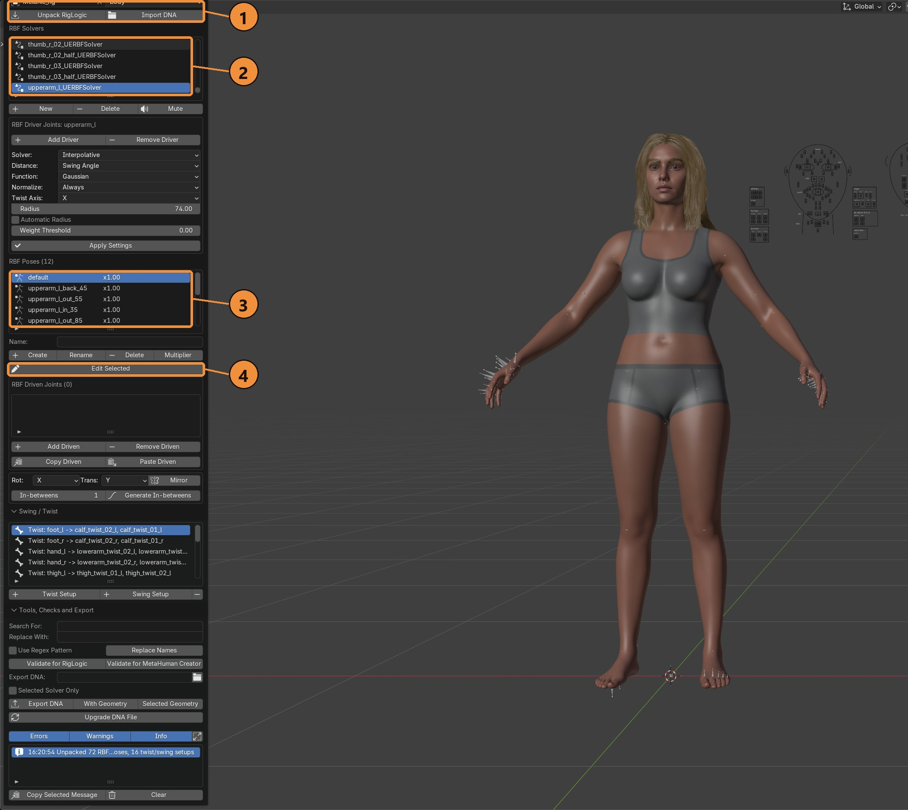

# Pose Editor

*Part of the [MetaHuman for Blender guide](HOW_TO_USE.md). Previous: [Joints Matching](joints-matching.md). Next: [Groom Exporter](groom-exporter.md).*

The Pose Editor edits the RBF corrective poses that fix shoulders, elbows, knees, the neck and so on
when they bend. Each **solver** watches one or more driver joints (say, the upper arm); each
**pose** is one position of those drivers (arm raised forward 110°) together with how the helper
joints around it should move in that position (the **driven** joints).

**Open it:** in the 3D Viewport press <kbd>N</kbd>, open the **MetaHuman** tab and expand
**Pose Editor**, or use the **MetaHuman** menu in the top bar → **Pose Editor**.
Save your .blend file first: your edits go into a working copy of the DNA next to it.

## Edit a corrective pose, step by step

1. **Pick the armature and the rig kind** at the top: **Body** for the body correctives, or
   **Face / Neck** for the neck. With separate skeletons, pick `<name>_body_rig` for Body and
   `<name>_head_rig` for Face / Neck. Then click **Unpack RigLogic.** The log at the bottom says
   how many solvers, poses and twist/swing setups it found.
2. **Pick a solver** in **RBF Solvers**, for example `upperarm_l_UERBFSolver`.
3. **Pick a pose** in **RBF Poses**, for example `upperarm_l_fwd_110`.
4. **Click Edit Selected.** The driver joints go into that pose, and the live rig for that part
   pauses so you can shape it. For Face / Neck that pauses the whole face, board included.
5. **Shape it:** select the character's armature, switch to **Pose Mode**, and move or rotate the
   joints listed under **RBF Driven Joints** until the shape looks right. Then click **Update.**
   Update stores only the joints in that list: to add a joint, select its bone in Pose Mode and
   click **Add Driven** first.
6. **Click Finish Editing.** The live rig runs again and shows your new pose.

## Manage poses and solvers

- **Poses:** **Create** (name it in **Name**, or it gets `<solver>_pose<N>`), **Rename**,
  **Delete**, **Mirror** a pose to the other side, **Generate In-betweens**, **Copy Driven** and
  **Paste Driven**, **Multiplier** and **Mute**.
- **Solvers:** **New** (select the driver bones in Pose Mode first) and **Delete**. Set the
  driver and driven joints, change the solver settings, and **click Apply Settings before you
  pick another solver or pose**: picking one reloads the settings and drops unapplied changes.

## Twist and swing joints

In **Swing / Twist**, in Pose Mode, select the twist bones first, then <kbd>Shift</kbd>-click the
driver bone **last**, so it is the active bone. Then click **Twist Setup** or **Swing Setup**. They
use the **Twist Axis** from the solver settings.

- **Generate Default Swing Twist Setup** builds the standard ones.
- **–** (Delete Setup) removes the selected one.

## Tools, Checks and Export

- **Replace Names** finds and replaces names (tick *Use Regex Pattern* for patterns).
- **Validate for RigLogic** and **Validate for MetaHuman Creator** check the setup; the details
  go to the log.
- **Log:** filter by **Errors**, **Warnings** and **Info**; **Copy Selected Message** and
  **Clear**.
- **Export DNA** writes all solvers to the **Export DNA** path, **With Geometry** also writes the
  mesh shapes, and **Selected Solver Only** exports just the selected solver's edits.
- **Upgrade DNA File** converts an older DNA file to version 2.5 (`<name>_v25.dna`).

Your edits go into a working copy next to the .blend file (`<name>_edit.dna`). The live rig reads
that copy, so you see the effect straight away.

## If something doesn't work

- **Every button except Unpack is greyed out.** The armature has no DNA for the chosen kind:
  pick the right armature and kind (step 1), or assemble the character first.
- **"… has no body DNA; assemble it with the Character Assembler first"** (or *head DNA*). Same
  cause: with separate skeletons, Body needs `_body_rig` and Face / Neck needs `_head_rig`.
- **The face or body stopped moving.** A pose is still being edited: click **Finish Editing.**
- **Update didn't keep a joint you moved.** It isn't in **RBF Driven Joints**: select it in Pose
  Mode, click **Add Driven**, move it again and click **Update.**
- **"Select the twist bones, then the driver bone last (active)".** Select them in that order
  in Pose Mode, with the driver last.
- **"… has no left/right marker to mirror".** Mirror needs `_l`/`_r`, `_L`/`_R`, `left` or
  `right` in the pose name.
- **"Set the Export DNA path first".** Fill in **Export DNA** under *Tools, Checks and Export*.
