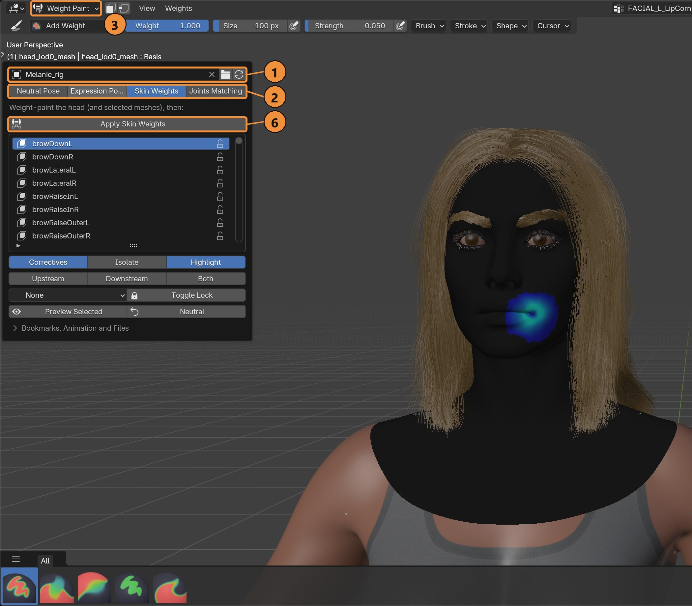

# Skin Weights

*Part of the [MetaHuman for Blender guide](HOW_TO_USE.md), Expression Editor. Previous: [Expression Poses](expression-poses.md). Next: [Joints Matching](joints-matching.md).*

The **Skin Weights** tab of the Expression Editor stores the weights you paint in Blender back in
the DNA. Skin weights decide how much each face joint moves each vertex, so they shape how the
jaw, lips, cheeks and brows deform.

**Open it:** in the 3D Viewport press <kbd>N</kbd>, open the **MetaHuman** tab and expand
**Expression Editor**, or use the **MetaHuman** menu in the top bar → **Expression Editor**.
Save your .blend file first: your changes go into a working copy of the DNA next to it.

## Paint the weights, step by step

1. **Pick the character's rig** in the field at the top.
2. **Open the Skin Weights tab.**
3. **Select the head mesh** (`head_lod0_mesh`) and switch to **Weight Paint** in the mode menu at
   the top left of the 3D Viewport.
4. **Pick the joint to paint** in **Properties → Object Data (green triangle) → Vertex Groups**.
   Each face joint has a vertex group with its name, such as `FACIAL_L_LipCorner`. To see where a
   joint sits, show the armature's hidden *Face Joints* collection in **Armature Data → Bone
   Collections**.
5. **Paint.** To change other head meshes too (teeth, eyes, eyelashes and so on), paint them and
   keep them selected along with the head.
6. **Click Apply Skin Weights.** The status line says how many meshes were stored.

## What Apply Skin Weights does

For every vertex of the head, and of the other selected head meshes:

- it keeps the joints with the strongest weights, up to the mesh's limit in the DNA (8 when the DNA
  gives none), and drops the weakest;
- it drops weights of zero;
- it scales the rest so they add up to 1.

Vertex groups that aren't named after a joint are ignored. Body meshes are never changed here.

## Afterwards

- [Joints Matching](joints-matching.md) uses the skin weights. After a big change to the weights
  on a reshaped face, run it so the joints fit the face.
- The weights go into the working copy of the DNA next to your .blend file (`<name>_edit.dna`).
  **Save MetaHuman DNA** (under *Bookmarks, Animation and Files*) writes them to a DNA file of your
  own.

## If something doesn't work

- **The buttons are greyed out** and the panel says *Load or pick an assembled head*. Pick the
  rig at the top (step 1).
- **Weight Paint isn't in the mode menu.** The active object isn't a mesh: click
  `head_lod0_mesh` in the Outliner first.
- **Painting changes nothing you can see.** The vertex group you paint is not the joint you're
  looking at: check the active group in **Vertex Groups**.
- **A mesh you painted wasn't stored.** Only the head and the other *selected* head meshes are
  stored; select them before clicking **Apply Skin Weights**.
