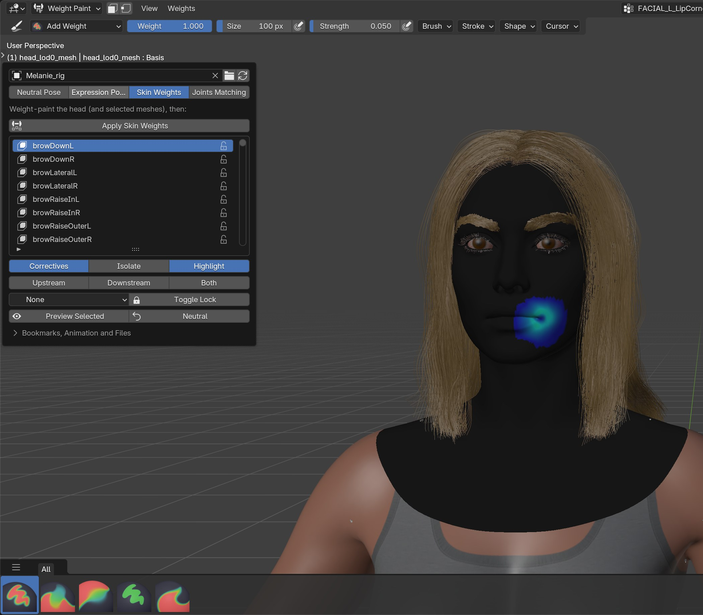

# Skin Weights

*Part of the [MetaHuman for Blender guide](HOW_TO_USE.md), Expression Editor. Previous: [Expression Poses](expression-poses.md). Next: [Joints Matching](joints-matching.md).*

The **Skin Weights** tab of the Expression Editor stores the weights you paint in Blender back in
the DNA. Skin weights decide how much each face joint moves each vertex, so they shape how the
jaw, lips, cheeks and brows deform.

## Paint the weights

1. Open the **Expression Editor**, pick the character's rig and switch to the **Skin Weights**
   tab.
2. Select the head mesh (`head_lod0_mesh`) and switch to **Weight Paint** mode.
3. Pick the joint to paint in **Object Data Properties → Vertex Groups**. Each face joint has a
   vertex group with its name, such as `FACIAL_L_LipCorner`. The face joints themselves are in the
   armature's hidden *Face Joints* bone collection; show it in **Armature Data → Bone Collections**
   to see where a joint sits.
4. Paint. To change other head meshes too (teeth, eyes, eyelashes and so on), paint them and keep
   them selected along with the head.
5. Click **Apply Skin Weights**. The status line says how many meshes were stored.

## What Apply Skin Weights does

For every vertex of the head, and of the other selected head meshes:

- it keeps the joints with the strongest weights, up to the mesh's limit in the DNA (8 when the DNA
  gives none), and drops the weakest;
- it drops weights of zero;
- it scales the rest so they add up to 1.

Vertex groups that aren't named after a joint are ignored. Body meshes are never changed here.

## Afterwards

- [Joints Matching](joints-matching.md) uses the skin weights. After a big change to the weights,
  run it again so the joints fit the face.
- The weights go into the working copy of the DNA next to your .blend file (`<name>_edit.dna`).
  **Save MetaHuman DNA** (under *Bookmarks, Animation and Files*) writes them to a DNA file of your
  own.
